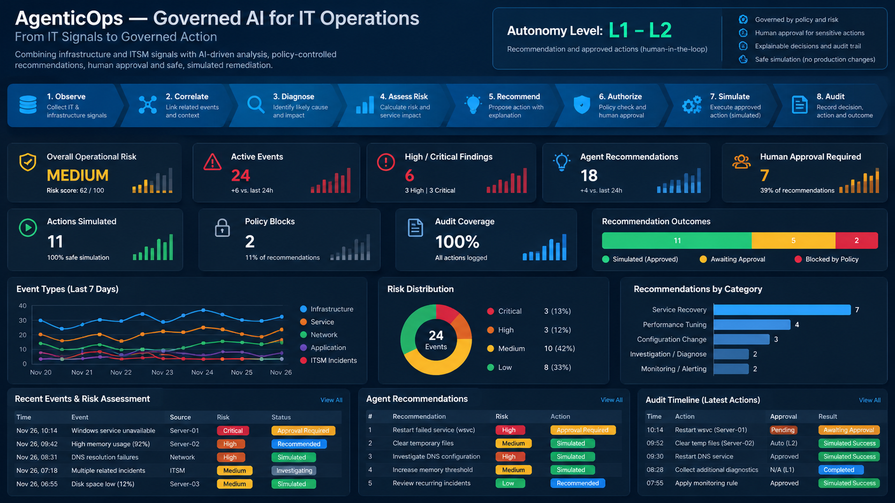
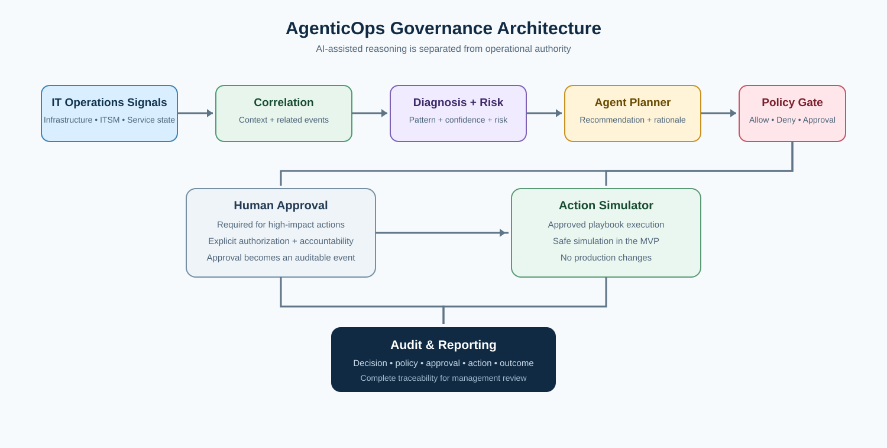

# AgenticOps — Governed AI for IT Operations

[](https://github.com/shahidalparvezmalik/agentic-it-operations/actions/workflows/python.yml)

AgenticOps is a safe, reproducible proof of concept showing how AI-assisted IT Operations can move from technical signals to governed operational action.

The project focuses on a practical operating model:

**Observe → Correlate → Diagnose → Assess Risk → Recommend → Authorize → Simulate Action → Audit**

The prototype does **not** grant unrestricted production access to an AI agent. High-impact actions require explicit human approval, while only predefined low-risk actions may be considered for controlled automation.

## Executive View



The executive dashboard connects operational risk, active events, agent recommendations, human-approval requirements and audit coverage in one management-oriented view.

## Governance Architecture



The architecture separates AI-assisted reasoning from operational authority. Policy controls sit between recommendation and action, while audit records preserve the decision path.

## What This Project Demonstrates

- Event correlation across infrastructure and ITSM-style signals
- Deterministic diagnosis and risk assessment
- AI-agent-style planning and action recommendations
- Policy-based autonomy and human-in-the-loop controls
- Safe remediation simulation
- Structured audit trails
- Unit testing and GitHub Actions validation
- Management-oriented operational reporting

## Architecture

```text
              IT OPERATIONS SIGNALS
                       │
        ┌──────────────┼──────────────┐
        │              │              │
     Health         ITSM Events    Service State
     Signals        Incidents       Checks
        │              │              │
        └──────────────┼──────────────┘
                       ↓
              ┌─────────────────┐
              │ Correlation     │
              │ & Diagnosis     │
              └────────┬────────┘
                       ↓
              ┌─────────────────┐
              │ Risk Assessment │
              └────────┬────────┘
                       ↓
              ┌─────────────────┐
              │ Agent Planner   │
              │ Recommendation  │
              └────────┬────────┘
                       ↓
              ┌─────────────────┐
              │ Policy Engine   │
              │ Guardrails      │
              └────────┬────────┘
                       ↓
             ┌─────────┴─────────┐
             │                   │
      LOW-RISK PATH        HUMAN APPROVAL
             │                   │
             └─────────┬─────────┘
                       ↓
              ┌─────────────────┐
              │ Action Simulator│
              └────────┬────────┘
                       ↓
              ┌─────────────────┐
              │ Audit & Report  │
              └─────────────────┘
```

## Autonomy Model

| Level | Operating mode | Example | Approval |
|---|---|---|---|
| L0 | Observe | Collect and classify signals | Not applicable |
| L1 | Recommend | Suggest remediation | Human review |
| L2 | Approved Action | Execute an approved playbook | Explicit approval |
| L3 | Controlled Autonomous | Low-risk predefined action | Policy-controlled |
| L4 | Restricted | High-impact or irreversible action | Human authorization required |

The prototype emphasizes **L1–L2** and safely simulates selected L3 behavior.

## Example Scenario

A service becomes unavailable while host resource utilization is elevated.

```text
Event:
Windows service unavailable

Related signals:
CPU: 82%
Memory: 88%
Network: OK
DNS: OK
Service: FAILED
Recent incidents: 4

Risk:
HIGH

Recommendation:
Restart approved service

Policy:
Human approval REQUIRED

Execution:
SIMULATED

Audit:
Decision + policy + action + result recorded
```

## Repository Structure

```text
agentic-it-operations/
├── README.md
├── LICENSE
├── .gitignore
├── requirements.txt
├── config/
│   ├── policies.json
│   ├── playbooks.json
│   └── thresholds.json
├── data/
│   ├── events.json
│   ├── incidents.json
│   └── README.md
├── src/
│   ├── event_correlator.py
│   ├── diagnosis_engine.py
│   ├── risk_engine.py
│   ├── agent_planner.py
│   ├── policy_engine.py
│   ├── action_simulator.py
│   ├── audit_logger.py
│   └── report.py
├── examples/
│   └── run_demo.py
├── tests/
│   ├── test_risk_engine.py
│   ├── test_policy_engine.py
│   └── test_workflow.py
├── docs/
│   ├── ARCHITECTURE.md
│   ├── GOVERNANCE.md
│   ├── AUTONOMY_MODEL.md
│   ├── ACTION_POLICY.md
│   ├── RISK_MODEL.md
│   ├── LINKEDIN_ARTICLE.md
│   ├── LINKEDIN_PROMOTION_POST.md
│   └── images/
│       ├── agenticops-executive-dashboard.png
│       └── agenticops-architecture.svg
└── .github/
    └── workflows/
        └── python.yml
```

## Getting Started

Requires Python 3.11+.

```bash
python examples/run_demo.py
python -m unittest discover -s tests -p "test_*.py"
```

The demo is deterministic and does not require an external AI API, cloud account, or production infrastructure access.

## Safety and Governance

This is a portfolio proof of concept, not a production automation framework.

Key controls:

- Human approval for high-risk actions
- Explicit allow-lists for available playbooks
- Confidence and risk thresholds
- Simulated execution by default
- Audit logging of decisions and outcomes
- No unrestricted shell or remote execution
- No real customer, employer, or production data

See [Governance](docs/GOVERNANCE.md), [Autonomy Model](docs/AUTONOMY_MODEL.md), and [Action Policy](docs/ACTION_POLICY.md).

## Professional Relevance

AgenticOps extends the portfolio's progression:

1. **IT Operations Dashboard** — ITSM data → operational visibility
2. **AI-Assisted IT Service Desk** — AI → governed recommendation and workflow
3. **Infrastructure Health Check** — technical telemetry → operational risk
4. **AgenticOps** — operational signals → governed AI decision → controlled action

The objective is not autonomous action for its own sake. The objective is to improve operational decision quality while preserving accountability, control, and service reliability.

## 2026 Industry Context

Agentic AI is becoming an explicit Infrastructure & Operations priority. Gartner's 2026 research emphasizes the move from AI assistance toward governed autonomy, runtime guardrails and an operating model designed around risk and control.

Cisco has also positioned AgenticOps as an agent-first IT operating model spanning networking, security and observability, with built-in oversight.

- [Gartner — 2026 Heads of Infrastructure and IT Operations Priority: Scaling Agentic AI in I&O](https://www.gartner.com/en/documents/8404181)
- [Gartner — Agentic AI Governance Framework for Infrastructure and IT Operations](https://www.gartner.com/en/documents/7885177)
- [Cisco — Cisco Expands AgenticOps Innovations Across Portfolio](https://newsroom.cisco.com/c/r/newsroom/en/us/a/y2026/m02/cisco-expands-agenticops-innovations-across-portfolio.html)

## Project Status

**Phase 1 — Portfolio MVP**

Current scope:

- Synthetic event data
- Deterministic correlation and diagnosis
- Risk scoring
- Policy-controlled recommendations
- Human approval simulation
- Action simulation
- Audit logging
- Executive dashboard
- Governance architecture visual
- Tests and CI validation
- LinkedIn article draft
- LinkedIn promotion post

Future enhancements may include optional LLM-assisted reasoning, CMDB/ITSM integration, observability data, approval APIs, service-impact mapping, agent identity controls and additional autonomy policies.

---

> **Observe intelligently. Decide responsibly. Automate with control.**
